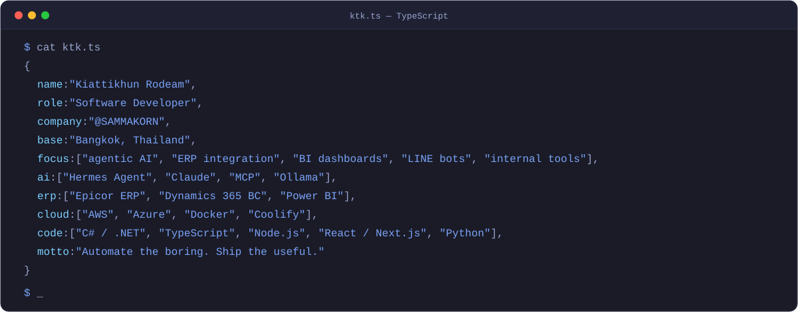
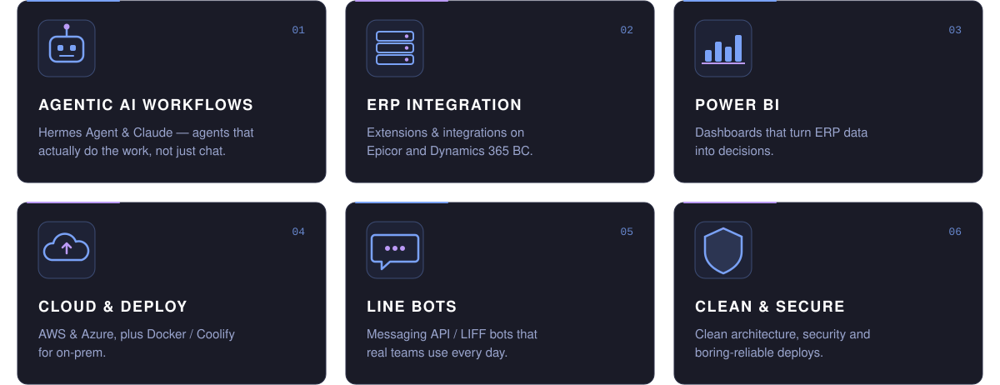
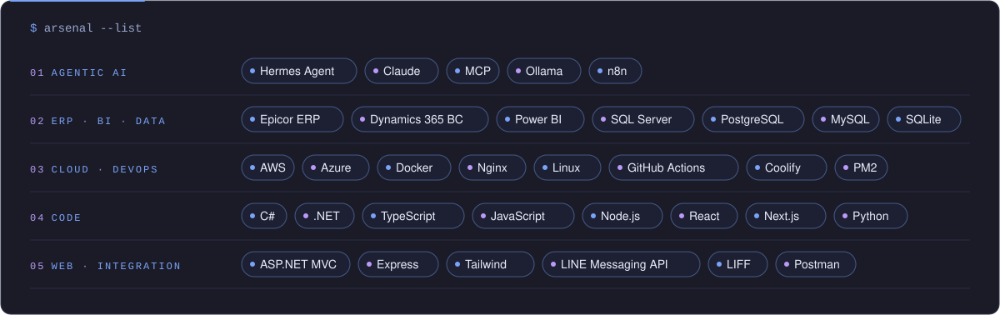

  

👋 สวัสดีครับ — I'm <b>KTK</b>, building internal platforms at <a href="https://github.com/SAMMAKORN"><b>@SAMMAKORN</b></a>.

  

  

 

 

  

  

<picture>
  <source media="(prefers-color-scheme: dark)" srcset="https://raw.githubusercontent.com/SAMCO-KTK/SAMCO-KTK/output/github-snake-dark.svg"/>
  <source media="(prefers-color-scheme: light)" srcset="https://raw.githubusercontent.com/SAMCO-KTK/SAMCO-KTK/output/github-snake.svg"/>
  
</picture>

  

  

